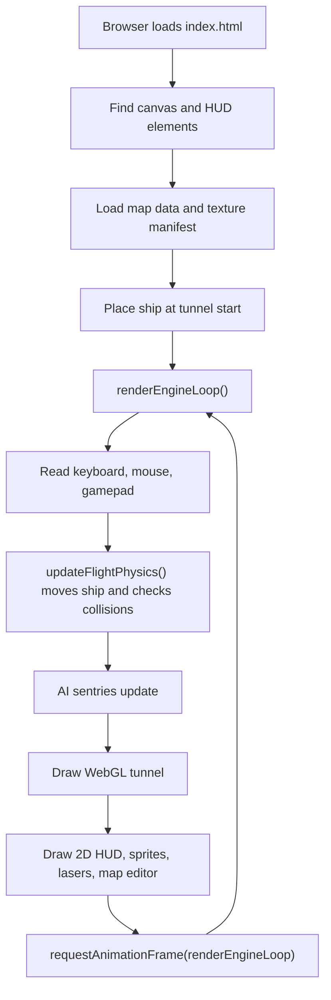
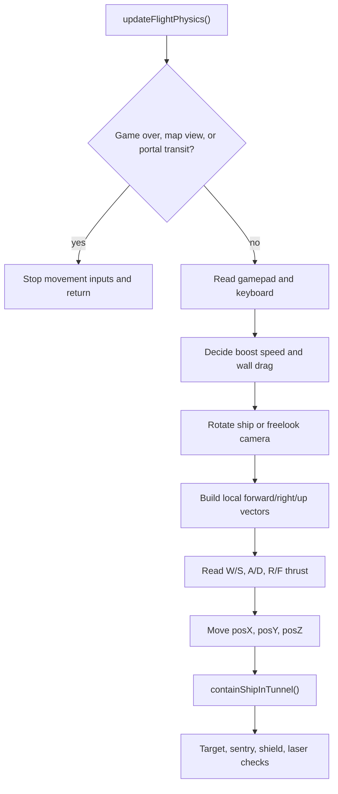
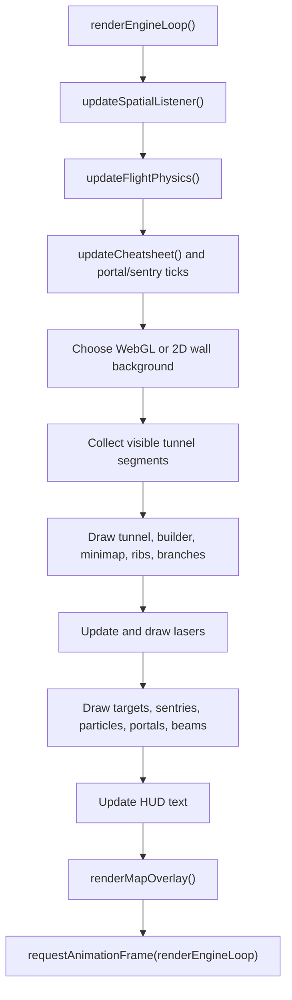

# Astral Drift Technical Reference

> **Living reference.** Update this page whenever a user-visible subsystem, map-data contract, safety boundary, or performance path changes. Add a dated entry to the timeline first, then update the affected main section in the same change. Timeline notes record verified source and test status; they do not replace real-map browser verification.

## Update Timeline (newest first)

### 2026-09-08 — Defender 3D Arcade Stage (Bonus 3) & Instant 180° Reverse Flip

- Added `defenderPhase` (toggle with `Alt+D` or `Ctrl+Shift+D`): 1st-person 6DOF open-space Defender arcade prototype featuring seamless horizontal toroidal wrapping ($X \in [-3500, +3500]$), starfield, and procedural planetary surface ridge.
- Enemies include Landers (abducting ground humanoids toward stratosphere ceiling), Mutants (fast hyper-aggressive pursuit), Bombers (deploying space minefields), Pods (splitting into 5 Swarmers), Baiter (anti-camp interceptor), and enemy projectile fire.
- Humanoid rescue mechanic: shooting an abducting Lander drops the astronaut; catching them mid-air awards +500 pts, returning them safely to the surface awards +500 pts.
- Smart Bomb capability: press `Space` or `B` in Defender mode to vaporize visible threats.
- Top-mounted long-range wrapping radar scanner displays all entities, terrain, and player ship.
- Added `instant180Flip()` (`Z`, `Shift+S`, and `X` in Defender mode): cleanly reverses nose and right wing while preserving orthonormal up/down basis and camera sync.

### 2026-09-04 — Distance-mapping Apply no longer a silent no-op

- V-dialog **Across distance** and **Fit one image** were rejecting Apply unless `selectionPath` matched the selection exactly and the path contained zero rooms/junctions. The dialog stayed open, so it looked like Apply did nothing. Legacy per-section mode never used that path check.
- Apply now orders any connected corridor selection (Alt+Shift range or Shift+click), skips rooms/junctions, and can apply multiple corridor runs. Failures show in the Scenic Mapping hint in red.

### 2026-09-04 — Sweep-ribbon tunnel walls (gap-free texture runs)

- WebGL corridor walls are no longer independent unit cylinders butted at each section. Connected tubes are one **sweep ribbon**: rings along a filleted centerline, UVs from arc length, one draw (or one draw per sequential pack image) per run.
- Collision, builder topology, and map save still own per-section capsules. Only the wall **render mesh** changed.
- Black join gaps on bends were a geometry hole (two end-circles in different planes), not a wrap-mode bug. Overlap sleeves, `MIRRORED_REPEAT`, and the chord bend-connector were retired from the WebGL path for swept tubes.
- Pilot-verified: one scenic image stretched along a long distance-run, including heavy bends, with no black cracks. Texture-to-texture handoffs share a single ring; sequential 5-tile packs meet as authored pictures, not as a hole.
- Mesh cache version is `sweepRibbon2`. Hard-refresh after pulling. Vector/2D fallback still uses the old per-section overlap path.

### 2026-08-26 — Gullet Maze 1 hard copy + playtest fixes

- `data/gullet-maze-library.json` is a shareable library backup for Gullet Maze 1 (`localhost:8127` vs live vs `file://` do not share localStorage). Alt+Shift+P or the map-library **Export Gullet Maze** button also downloads it. `bootstrapGulletMazeIfMissing()` merges that named map into the current origin without replacing the player's tunnel.
- Level 1–3 use 2 floors and fewer mid-hall gates. HUD mini-map starts blank and fills room-by-room; gates, jellies, and the Maw no longer draw through walls; lasers cannot clear gates (fly-through only).

### 2026-08-25 — Gullet arcade maze phase

- `startGulletPhase(level)` / Alt+P swaps in a temporary rectangular-room arena (2 floors on L1–3, 3 from L4), then restores the host map without saving. Target-box gates, surge stashes, jellyfish patrols, and an unkillable Maw live only while the phase is active.
- Map save is blocked during Gullet so the generated arena cannot overwrite the player's tunnel.

### 2026-08-24 — Scoped large-map rendering optimization

- A 1,001-segment map remains fully loaded in `builder.segments`; no geometry is unloaded or streamed. The complete map stays authoritative for saving, editing, route topology, and safety fallbacks.
- `tunnelSpatialIndex` now lazily indexes bounded segment world-bounds into 1,200-unit cells after a geometry/cache invalidation. Collision fallback and non-opaque visibility queries use nearby candidates plus a conservative global set for malformed or exceptionally large segments.
- Branch-mouth entries are cached between geometry changes, and tunnel ribs iterate the current/forward route set rather than repeatedly walking unrelated segments.
- `test_spatial_segment_index.js` passed with a synthetic 1,001-segment map: a local query stayed bounded and an oversized segment remained queryable. The normal local browser smoke test loaded a 54-segment autosave without console warnings; it is **not** proof of the pilot's actual 1,001-segment route performance.
- Next performance proof: load the actual large map in a normal local-browser origin, fly the known slow route with HUD shown and hidden, include dense junctions and an edit/return pass, then profile the minimap before considering any streaming design.

### 2026-08-24 — Map-import and entity admission guards

- `MAP_IMPORT_MAX_SEGMENTS` is 2,000 for every map source. A 2,001-segment map is rejected before it mutates active geometry or enters quadratic sanitization.
- Sentry patrol paths are capped at 256 points, imported vectors must be finite, and duplicate sentry IDs are regenerated. Focused import/entity regression tests passed.

### 2026-08-24 — Collision and WebGL lifecycle review

- Static source review found no confirmed containment bypass, stale geometry cache, or WebGL resource-lifecycle defect in the reviewed paths. Dynamic verification of the real large map and an intentional WebGL context-loss/recovery exercise remains open.

### 2026-08-19 — Track 1 baseline and safety inventory

- The current one-file game architecture, map-import path, collision ownership, sentry reconstruction, and WebGL resource lifecycle became the focused audit track. Completed findings are recorded in `../docs/adversarial_systems_audit_log.md`; resume from its newest dated handoff rather than repeating closed checks.

This guide is for a new coder opening `index.html` and wondering where to start.
Astral Drift is a one-file browser game: HTML creates the page, CSS styles the
HUD, and one large JavaScript block runs the game, map editor, AI sentries,
textures, physics, saves, and rendering.

## How To Run It

Best path:

```powershell
cd C:\Users\Linda\trading_bot_v2\DecentClone
..\venv312\Scripts\python.exe -m http.server 8127
```

Then open:

```text
http://localhost:8127/index.html
```

Why not double-click `index.html`? Browser `file://` security often blocks local
textures and manifests. The game can fall back to procedural textures, but the
local server is the real testing path.

## Big Mental Model

Think of the game as a loop:



Every feature usually touches one of these areas:

- Input: key and mouse handlers decide what the pilot asked for.
- State: global objects remember ship, map, AI, target, and editor state.
- Simulation: `updateFlightPhysics()` moves the player and runs collisions.
- Rendering: `renderEngineLoop()` draws everything.
- Saving: builder edits go through `applyMapGeometryChange()`.

## Most Important Files

`index.html`

The game itself. The JavaScript starts inside the `<script>` tag near the bottom
of the file. Most work happens here.

`Textures/texture_manifest.json`

Lists wall, AI, and effect textures the game can load by id.

`data/map_library_bundle.json`

Bootstrapped map library used when the local browser storage does not already
have a saved map.

`TASKS_FOR_CODEX_AND_CLAIUDE.md`

Current task stack and safety rules.

`test_map_import_segment_limit.js`, `test_map_entity_sanitizers.js`, and `test_spatial_segment_index.js`

Small Node regression checks for map admission, imported entity sanitization, and the large-map spatial-index contract. They validate specific invariants; a normal-browser run still validates the game integration.

## First Landmarks In index.html

### DOM And HUD Startup

Near the top of the script, the code grabs important page elements:

```js
const canvas = document.getElementById('fallback-canvas');
const ctx = canvas.getContext('2d', { alpha: true });
const keyboardStatus = document.getElementById('keyboard-val');
```

This is how the JavaScript talks to the page. `canvas` is the drawing surface,
`ctx` is the 2D drawing tool, and the HUD elements are where status text goes.

### Ship State

Look for `Ship flight state`.

The important variables are:

- `posX`, `posY`, `posZ`: where the cockpit is in the world.
- `shipForward`: where the nose points.
- `shipRight`: where the right wing points.
- `shipDown`: where the cockpit floor points.
- `viewForward`, `viewRight`, `viewDown`: where the camera looks during free-look
  or snap views.
- `lastForwardAmount`, `boostingForward`: used by sound, FOV stretch, and speed
  effects.

Beginner rule: do not move the ship by changing the screen pixels. Move the
ship by changing world position and direction, then let rendering draw the new
view.

### Builder And Map State

Look for `mapMouse`.

`mapMouse` is the editor's short-term memory:

- `anchor`: point A.
- `destination`: point B.
- `midpoint`: optional curve handle C for a single join.
- `routeDraft`: multi-node route preview.
- `selection`: selected tunnel sections.
- `targetSelection`: selected target boxes.
- `joinMode`: tunnel, portal, or sentry mode.
- `editPlane`: current CAD plane, usually `xy`, `yz`, or `zx`.

If a map-editor tool feels confused, inspect `mapMouse` first.

### Texture And Wall Rendering

Look for `Tunnel wall rendering controls` and `WebGL gap-free tunnel renderer`.
The live corridor path is the **sweep ribbon** (`renderSweepTubesWebGL`, cache
version `sweepRibbon2`). Do not revive per-section cylinder joins to "fix" a
seam.

The game uses two drawing layers:

- WebGL canvas: fast textured tunnel walls.
- 2D canvas: HUD, lasers, sprites, sentries, target boxes, fallback visuals,
  and the map editor.

Tunnel wall opacity is saved per section as `wallOpaque`. Missing values from
older maps are treated as `true`, so old maps load as dense opaque tunnels. To
make a special see-through section, select one or more tunnel sections in the 3D
map, press `V`, and uncheck `Opaque tunnel walls`.

Builder-selected segments can also be converted with **Make Chamber**. Chambers
render as fully textured 360-degree spherical rooms and use chamber-aware
containment for free flight in every direction. Door-marked portals connect
these rooms to the tunnel network for quest rooms, loot, traps, or guarded areas.

#### Sweep ribbon (WebGL corridors)

Map data is still a polyline of sections. Flight collision uses those capsules.
WebGL walls for ordinary round tubes do **not** instance a unit cylinder per
section. Adjacent cylinders cannot form a watertight elbow: the inner bend is a
wedge (clear color reads as a black gap), worst on curves.

`renderTunnelWebGL()` now:

1. Collects connected sweepable tubes (`collectCorridorSweepChunks`).
2. Builds a world-space ring strip (`buildSweepPathSamples` + `buildSweepTubeGpuMesh`).
3. Marks those section indices `sweepCovered` and **skips** their old cylinder draws.
4. Does **not** call `renderDistanceBendConnectorsWebGL` for those walls.

What is sweepable: round corridor segments that are not rect-rooms, spherical
chambers, or round six-port hubs. Those special kinds keep their existing meshes.

**Centerline.** Walk the distance-run order when `wallMappingMode` is
`distance-run`; otherwise walk unique degree-2 neighbors. At each turn sharper
than `TUNNEL_SWEEP_MIN_TURN_RAD` (~7°) and under `TUNNEL_SWEEP_MAX_TURN_RAD`
(~170°), `planSweepFillet()` inserts a circular arc. Gentle joints stay
polyline. Hard 90° bends are extra rings on that arc, not two butted tubes.

**UVs.** `U` is the circumference around a parallel-transported frame (same
idea as `transportTextureRunReference`). `V` is cumulative arc length along the
ribbon. A distance-run chunk maps `V` 0..1 across that image so a 5-tile set
stretched over many sections stays one mural around a bend.

**Texture handoff.** A run may still change `wallTextureId` (pack tiles
01–05). Geometry stays one path. Draws split with `sweepTextureRanges` /
`sliceSweepSamplesForEntries`. The next image **shares the previous image's
last ring** (one edge, no overlapping sleeves). `U` scale/offset come from the
**first segment of the whole run**, not each tile, so the mural does not spin
at the file change. `V` restarts 0..1 per image. Authored pack edges should
meet; a picture change is expected, a black crack is not.

**Wrap.** Section/scenic textures use `CLAMP_TO_EDGE` on `T`. Tiled rock still
`REPEAT`. Do not switch scenic walls back to `MIRRORED_REPEAT` to hide joins;
that collar existed to paper over overlap geometry the ribbon no longer draws.

**Leave alone.** `TUNNEL_SECTION_JOIN_OVERLAP`, `TUNNEL_SEGMENT_JOIN_OVERLAP`,
and `TUNNEL_TEXTURE_PANEL_OVERLAP` still exist for the vector fallback and for
unswept meshes. Increasing them will not improve the WebGL ribbon and can
bring back sleeves across branch mouths.

Search terms: `renderSweepTubesWebGL`, `buildSweepPathSamples`,
`planSweepFillet`, `collectDistanceSweepChunks`, `sweepCovered`,
`sweepRibbon2`.

## Flight Flow

The main flight function is `updateFlightPhysics()`.

High-level flow:



AutoBoost lives in this function around the `boosting`, `manualKeyForward`,
`keyForward`, and `forwardAmount` logic. That is where the game decides whether
the player is cruising, boosting, reversing, or stopped.

Current AutoBoost behavior:

- Press `;` while flying to toggle it.
- If enabled while cruising with W, it holds normal forward thrust.
- If enabled while holding W+Shift, it holds turbo thrust.
- Press `S` or reverse on a gamepad to cancel immediately.
- The HUD view line shows `AUTOCRUISE` or `AUTOBOOST TURBO` while active.
- Opening map/builder mode, game over, portal transit, blur, or keyboard clear
  also turns it off.

## Rendering Flow

The main draw function is `renderEngineLoop()`.

High-level flow:



If the screen goes blank, search the browser console for `Astral Drift engine
error`. This loop catches errors and writes them to the canvas, which helps keep
debugging possible even when rendering breaks.

### WebGL context-loss recovery

The WebGL canvas is deliberately fail-soft. `bindWebGLContextRecovery()` handles a browser `webglcontextlost` event by preventing the default terminal loss, clearing stale GPU handles through `resetWebGLResourceState()`, hiding the WebGL layer, and switching wall rendering to vector mode. On `webglcontextrestored`, it clears handles again, reinitializes the renderer, and returns to WebGL only if initialization succeeds. This prevents a lost context from leaving an opaque black canvas over an otherwise runnable game.

When changing renderer resources, do not retain an old buffer, texture, shader program, or cached location across a context restore. Exercise the loss/restore path in a real browser after material WebGL changes.

## Builder Flow

Builder mode and map mode are different:

- `B`: builder cursor mode.
- `M`: full 3D map editor.
- `Ctrl+H`: toggle full help versus the compact vitals HUD.
- `Alt+M`: hide or restore the full HUD panel so it does not intercept mouse steering.

The full map editor is where most CAD-style tools live.

Basic tunnel edit:

1. Select endpoint or tunnel section A.
2. Set destination B with `Ctrl+LMB`.
3. Optionally set bend C with `Shift+Ctrl+LMB`.
4. Press `Y` to build.

Multi-route edit:

1. Press `N`.
2. Click route nodes on the active plane.
3. Drag route handles if needed.
4. Click a route line to edit its C-handle angle.
5. Press `Y` to generate the whole route.

Corkscrew route generator:

1. Select a tunnel endpoint A.
2. Press `Alt+N` and enter diameter, pitch, turns, axis, and direction.
3. Create the editable preview.
4. Inspect or adjust its normal route nodes and quadratic C handles.
5. Press `Y` to build it through the existing route chunking pipeline.

The generator supports fractional turns, taper, variable pitch, reverse/S helix,
and compatible fit-to-B routes. It intentionally has no bank/roll setting because
the tunnel has no intrinsic up direction. Generated data is a normal
`mapMouse.routeDraft`; no map-save schema extension is required.

Map persistence uses `Ctrl+Shift+S` to save a named map and `Ctrl+Shift+L` to
open the map library. The save prompt defaults to the currently loaded name so
Enter updates that map; autosave-only work defaults to a new timestamp name.
`Esc` cancels the active portal/sentry mode or clears
current selections and route/orbit drafts. The authoritative complete control
list is kept in the in-game mode cheat sheet and `NEXT_STEPS.md`.

The lower-right orientation cube is camera-relative and uses the same map-camera
basis as the grid and XYZ gizmo. Face clicks choose front/back/left/right/top/
bottom orthographic views and lock the corresponding edit plane. Beveled edges
and corners choose diagonal views while preserving the current plane. Separate
`XY`, `YZ`, and `XZ` buttons beneath the cube change only the locked work plane
and preserve the camera orientation. On the XYZ
gizmo, axes in the current plane are solid; the perpendicular world axis is
dashed and labeled with `⟂`. A world axis aimed nearly into the camera uses a
bounded vertical-mouse depth fallback instead of dividing by its tiny projected
screen length; this prevents accidental multi-thousand-unit point jumps. Direct
route/midpoint/range C dragging freezes its plane origin for the duration of the
drag, rejects near-parallel ray intersections, and bounds movement around that
starting C position.

The route system uses:

- `ensureRouteDraft()`
- `appendRouteDraftNode()`
- `makeRouteHandle()`
- `routePreviewPolyline()`
- `generateRouteDraftTunnel()`

## Map Save And Rebuild Contract

### Large-map query model

A large map is retained in full; this codebase currently scopes *queries*, not map ownership. `invalidateTunnelSegmentCache()` marks `tunnelSpatialIndex` and `branchMouthCache` stale along with the existing render/topology caches. The next nearby query rebuilds the spatial index from segment world bounds.

The index uses 1,200-unit cells. A normal segment is stored in every cell crossed by its padded bounds. A malformed segment or one covering more than 192 cells is placed in the index's global set instead, so it is never silently omitted by a local query. This deliberately favors correctness over a pathological performance win.

- `shipInsideAnyTunnelTube()` asks the index for the ship's local candidates, including global entries; it falls back to the complete map if no usable candidate query exists.
- `collectVisibleTunnelSegmentsUncached()` preserves the topology/forward-route path for opaque walls. In a glass or otherwise non-opaque current segment, it starts from spatial candidates, then adds the current route candidates so deliberate through-wall views retain their behavior.
- `getBranchMouthEntries()` caches static branch-mouth geometry until the next invalidation. `renderSegmentRibs()` restricts work to the current/forward route set.

This is intentionally not a streaming subsystem. Do not add unload/reload rules unless profiling the actual map proves the remaining full-map work—notably the minimap—is the bottleneck and a design preserves builder, collision, save, and topology correctness.

### Import segment safety limit

`MAP_IMPORT_MAX_SEGMENTS` in `index.html` is the single admission limit for
every saved-map source: pasted JSON, uploaded library backups, bootstrap files,
named maps, and the autosave. It is currently **2,000 segments**. Maps at or
below the limit load normally; a map with 2,001 or more segments is rejected
before it can replace `builder.segments`, invalidate render caches, or enter
the quadratic segment-sanitization pass.

When raising this value, change the named constant and this reference together,
then test an accepted map at the proposed limit and a rejected map one segment
above it. The limit is an availability guard, not a map-format change; existing
maps at or below the new value require no migration.

### Imported sentry and loot validation

`SENTRY_MAX_PATROL_POINTS` is currently **256**. It applies to both imported
patrol data and patrols completed or edited in the map UI, so one map cannot
make the AI tick or map overlay iterate an unbounded path. Valid paths longer
than the limit retain their first 256 points; malformed points are dropped and
non-finite linger times become zero.

Imported sentry spawn frames and rocket-cache position/orientation vectors must
be finite before reconstruction. Duplicate sentry IDs are regenerated during
import. These are admission guards only: normal finite map data remains in the
existing format and needs no migration.

Any code that changes `builder.segments` should call:

```js
applyMapGeometryChange('short status message');
```

That function does the important cleanup:

- Repairs tiny, duplicate, or badly joined segments.
- Rebuilds target references.
- Rebuilds tunnel stars and target boxes.
- Invalidates render, topology, spatial-index, and branch-mouth caches.
- Saves the map.

Do not replace it with a hand-written list unless there is a very specific
reason. Most geometry bugs come from changing the tunnel but forgetting one of
the rebuild steps.

## AI Sentries

Sentries are stored in builder/map data, then rebuilt into runtime sentries.
The task list asks that sentries stay visible and targetable after engagement.
Useful search terms:

- `tunnelSentries`
- `rebuildTunnelSentries`
- `tickSentries`
- `renderTunnelSentries`
- `checkLaserSentryHits`
- `SENTRY_CHASE_TRAIL_DIST`

Important idea: a sentry can exist in simulation but still feel "gone" if its
render position, chase anchor, or target projection is behind/inside the camera
too often. Debug both the AI position and the render projection.

## Targets And Lasers

Lasers are stored in the `lasers` array. Each frame:

1. A new laser gets a world position and velocity.
2. The render loop moves it.
3. It checks target hits and sentry hits.
4. It gets deleted after its lifetime ends or it leaves projection.

Useful search terms:

- `lasers`
- `checkLaserTargetHits`
- `checkLaserSentryHits`
- `renderLaserAimCrosshair`

## Debugging Checklist

When something breaks:

1. Run the script parse check.
2. Open the browser dev console.
3. Confirm the build stamp changed.
4. Hard refresh the browser.
5. If textures look wrong, run from `http://localhost:8127/index.html`.
6. If map edits vanish, inspect whether the edit called `applyMapGeometryChange()`.
7. If AI exists but cannot be shot, inspect both `tickSentries()` and
   `renderTunnelSentries()`.
8. After a large-map change, run `node DecentClone/test_spatial_segment_index.js` from the repo root, then load the real map through the local HTTP server. The synthetic regression does not measure a pilot route.
9. After a WebGL resource change, test normal rendering and the browser context-loss/recovery path; a static parse check cannot validate GPU resource ownership.
10. After a corridor-wall change, hard-refresh, fly a distance-run through a sharp bend, then a 5-tile pack handoff. Black wedges mean the ribbon is not covering the joint; a picture change without a hole is the pack edge. Do not raise join-overlap constants to hide it.

## Script Parse Check

Use this from the repo root:

```powershell
node -e "const fs=require('fs'); const html=fs.readFileSync('C:/Users/Linda/trading_bot_v2/DecentClone/index.html','utf8'); const m=html.match(/<script[^>]*>([\s\S]*)<\/script>/i); if(!m) throw new Error('script tag not found'); new Function(m[1]); console.log('script parse OK');"
```

This does not prove the game logic is perfect. It proves the JavaScript can
compile, which catches missing braces, bad commas, and many accidental edits.

## Where To Add The Next Tasks

Opaque walls:

- The saved segment flag is `wallOpaque`.
- The default is `defaultWallOpaque`.
- Missing old-map values are upgraded in `ensureSegmentStyle()`.
- WebGL uses `segmentWallAlpha()` through the `uAlpha` shader uniform.
- The JPG fallback uses the same `segmentWallAlpha()` helper.

Sweep-ribbon walls:

- Entry: `renderSweepTubesWebGL()` inside `renderTunnelWebGL()`.
- Path samples: `buildSweepPathSamples()` / `planSweepFillet()`.
- Pack splits: `sweepTextureRanges()` + `sliceSweepSamplesForEntries()`.
- Covered sections must stay in `sweepCovered` so the old cylinder path does not draw on top.
- Bump `TUNNEL_WEBGL_MESH_CACHE_VERSION` when ribbon vertex or UV rules change.

AutoBoost:

- State lives near ship/input variables as `autoBoostActive` and
  `autoBoostTurbo`.
- The primary keybindings are `Tab` and `;` in `handleKeyDown()`.
- `boosting` and `keyForward` are overridden inside `updateFlightPhysics()`.
- `S` and reverse gamepad input disable it immediately.

Spy-vs-Spy gadgets:

- Add inventory state near player score/lives/shields.
- Add HUD display near player HUD updates.
- Add deploy key handling near combat input.
- Add effects to the simulation loop.
- Add visible particles in render/update particle helpers.

Modular In-Game Help & Cheatsheet Architecture:

- Master Catalog: Defined in `HELP_CATALOG` with 9 modular categories:
  - `flight`: Flight thrusters, strafe, roll, boost (`Shift`), AutoCruise (`Tab`), instant 180° flip (`C` / `Space`), recover (`0`), level (`K`).
  - `combat`: Primary lasers (`V` / `RMB`), rockets (`X`), target boxes, sentry mechanics.
  - `cockpit`: Mouse steering (`~`), inventory (`I`), snap views (`1-6`), map plane (`H`), panel toggles (`Ctrl+H`, `Alt+M`).
  - `arcade`: Defender Bonus Stage (`Alt+D`), Smart Bomb (`B`), astronaut rescue, Galaga (`Ctrl+Shift+G`), Gullet maze (`Alt+P`).
  - `map`: 3D map orbit, pan, zoom, view cubes, grid snap (`,`, `.`, `\`), center (`9` / `0`).
  - `builder`: Segment extrusion (`T`), bend angles (`[` / `]`), planes (`Q`/`E`), branches (`O`), joins (`Y`), corkscrews (`Alt+N`), rooms & 6-port hubs (`V`).
  - `portals`: Portal mode (`8`), gateways (`Shift+Y`), loot caches (`6`), locked 3D ruler/protractor (`/`).
  - `sentries`: Sentry mode (`7`), spawn placement (`Ctrl+LMB`), patrol loops, guard/patrol inspection.
  - `guides`: Interactive collapsible procedure accordions with step-by-step instructions.
- Table of Contents / Category Pills: `.help-category-bar` with `.help-pill` buttons for instant filtering.
- Live Search: `.help-search-input` performs real-time substring search on keys and descriptions across categories; isolated from flight controls via `isDialogInputTarget()`. Pressing `Escape` clears and blurs the search input, returning focus to the canvas.
- Display Modes: Hides cleanly under `body.hud-mode-min` (vitals only) and `body.hud-mode-hidden`.
- Backwards Compatibility: Populates legacy `flightCheats`, `mapCheats`, `builderCheats`, `builderProcedures`, `#mode-cheatsheet`, `#player-command-list`, and `#player-action-list`.
