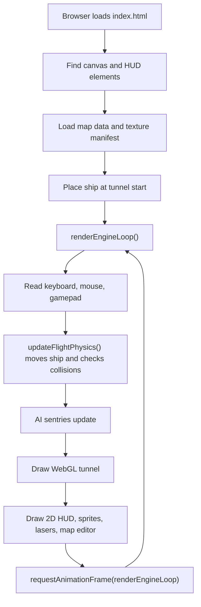
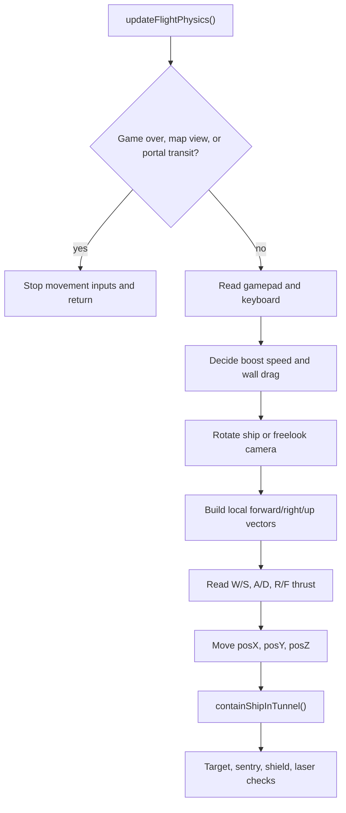
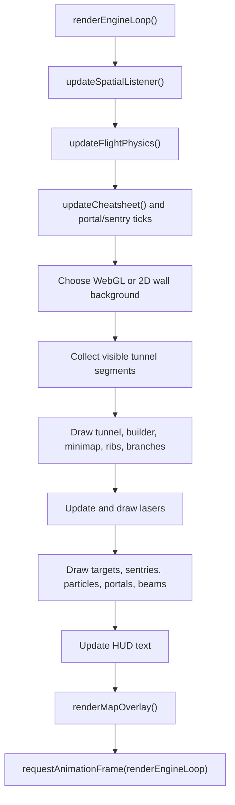

# Astral Drift Technical Reference

This guide is for a new coder opening `index.html` and wondering where to start.
Astral Drift is a one-file browser game: HTML creates the page, CSS styles the
HUD, and one large JavaScript block runs the game, map editor, AI sentries,
textures, physics, saves, and rendering.

## How To Run It

Best path:

```powershell
cd C:\Users\Linda\trading_bot_v2\DecentClone
..\venv312\Scripts\python.exe -m http.server 8127
```

Then open:

```text
http://localhost:8127/index.html
```

Why not double-click `index.html`? Browser `file://` security often blocks local
textures and manifests. The game can fall back to procedural textures, but the
local server is the real testing path.

## Big Mental Model

Think of the game as a loop:



Every feature usually touches one of these areas:

- Input: key and mouse handlers decide what the pilot asked for.
- State: global objects remember ship, map, AI, target, and editor state.
- Simulation: `updateFlightPhysics()` moves the player and runs collisions.
- Rendering: `renderEngineLoop()` draws everything.
- Saving: builder edits go through `applyMapGeometryChange()`.

## Most Important Files

`index.html`

The game itself. The JavaScript starts inside the `<script>` tag near the bottom
of the file. Most work happens here.

`Textures/texture_manifest.json`

Lists wall, AI, and effect textures the game can load by id.

`data/map_library_bundle.json`

Bootstrapped map library used when the local browser storage does not already
have a saved map.

`TASKS_FOR_CODEX_AND_CLAIUDE.md`

Current task stack and safety rules.

## First Landmarks In index.html

### DOM And HUD Startup

Near the top of the script, the code grabs important page elements:

```js
const canvas = document.getElementById('fallback-canvas');
const ctx = canvas.getContext('2d', { alpha: true });
const keyboardStatus = document.getElementById('keyboard-val');
```

This is how the JavaScript talks to the page. `canvas` is the drawing surface,
`ctx` is the 2D drawing tool, and the HUD elements are where status text goes.

### Ship State

Look for `Ship flight state`.

The important variables are:

- `posX`, `posY`, `posZ`: where the cockpit is in the world.
- `shipForward`: where the nose points.
- `shipRight`: where the right wing points.
- `shipDown`: where the cockpit floor points.
- `viewForward`, `viewRight`, `viewDown`: where the camera looks during free-look
  or snap views.
- `lastForwardAmount`, `boostingForward`: used by sound, FOV stretch, and speed
  effects.

Beginner rule: do not move the ship by changing the screen pixels. Move the
ship by changing world position and direction, then let rendering draw the new
view.

### Builder And Map State

Look for `mapMouse`.

`mapMouse` is the editor's short-term memory:

- `anchor`: point A.
- `destination`: point B.
- `midpoint`: optional curve handle C for a single join.
- `routeDraft`: multi-node route preview.
- `selection`: selected tunnel sections.
- `targetSelection`: selected target boxes.
- `joinMode`: tunnel, portal, or sentry mode.
- `editPlane`: current CAD plane, usually `xy`, `yz`, or `zx`.

If a map-editor tool feels confused, inspect `mapMouse` first.

### Texture And Wall Rendering

Look for `Tunnel wall rendering controls` and `WebGL gap-free tunnel renderer`.

The game uses two drawing layers:

- WebGL canvas: fast textured tunnel walls.
- 2D canvas: HUD, lasers, sprites, sentries, target boxes, fallback visuals,
  and the map editor.

Tunnel wall opacity is saved per section as `wallOpaque`. Missing values from
older maps are treated as `true`, so old maps load as dense opaque tunnels. To
make a special see-through section, select one or more tunnel sections in the 3D
map, press `V`, and uncheck `Opaque tunnel walls`.

## Flight Flow

The main flight function is `updateFlightPhysics()`.

High-level flow:



AutoBoost lives in this function around the `boosting`, `manualKeyForward`,
`keyForward`, and `forwardAmount` logic. That is where the game decides whether
the player is cruising, boosting, reversing, or stopped.

Current AutoBoost behavior:

- Press `;` while flying to toggle it.
- If enabled while cruising with W, it holds normal forward thrust.
- If enabled while holding W+Shift, it holds turbo thrust.
- Press `S` or reverse on a gamepad to cancel immediately.
- The HUD view line shows `AUTOCRUISE` or `AUTOBOOST TURBO` while active.
- Opening map/builder mode, game over, portal transit, blur, or keyboard clear
  also turns it off.

## Rendering Flow

The main draw function is `renderEngineLoop()`.

High-level flow:



If the screen goes blank, search the browser console for `Astral Drift engine
error`. This loop catches errors and writes them to the canvas, which helps keep
debugging possible even when rendering breaks.

## Builder Flow

Builder mode and map mode are different:

- `B`: builder cursor mode.
- `M`: full 3D map editor.

The full map editor is where most CAD-style tools live.

Basic tunnel edit:

1. Select endpoint or tunnel section A.
2. Set destination B with `Ctrl+LMB`.
3. Optionally set bend C with `Shift+Ctrl+LMB`.
4. Press `Y` to build.

Multi-route edit:

1. Press `N`.
2. Click route nodes on the active plane.
3. Drag route handles if needed.
4. Click a route line to edit its C-handle angle.
5. Press `Y` to generate the whole route.

The route system uses:

- `ensureRouteDraft()`
- `appendRouteDraftNode()`
- `makeRouteHandle()`
- `routePreviewPolyline()`
- `generateRouteDraftTunnel()`

## Map Save And Rebuild Contract

Any code that changes `builder.segments` should call:

```js
applyMapGeometryChange('short status message');
```

That function does the important cleanup:

- Repairs tiny, duplicate, or badly joined segments.
- Rebuilds target references.
- Rebuilds tunnel stars and target boxes.
- Invalidates render caches.
- Saves the map.

Do not replace it with a hand-written list unless there is a very specific
reason. Most geometry bugs come from changing the tunnel but forgetting one of
the rebuild steps.

## AI Sentries

Sentries are stored in builder/map data, then rebuilt into runtime sentries.
The task list asks that sentries stay visible and targetable after engagement.
Useful search terms:

- `tunnelSentries`
- `rebuildTunnelSentries`
- `tickSentries`
- `renderTunnelSentries`
- `checkLaserSentryHits`
- `SENTRY_CHASE_TRAIL_DIST`

Important idea: a sentry can exist in simulation but still feel "gone" if its
render position, chase anchor, or target projection is behind/inside the camera
too often. Debug both the AI position and the render projection.

## Targets And Lasers

Lasers are stored in the `lasers` array. Each frame:

1. A new laser gets a world position and velocity.
2. The render loop moves it.
3. It checks target hits and sentry hits.
4. It gets deleted after its lifetime ends or it leaves projection.

Useful search terms:

- `lasers`
- `checkLaserTargetHits`
- `checkLaserSentryHits`
- `renderLaserAimCrosshair`

## Debugging Checklist

When something breaks:

1. Run the script parse check.
2. Open the browser dev console.
3. Confirm the build stamp changed.
4. Hard refresh the browser.
5. If textures look wrong, run from `http://localhost:8127/index.html`.
6. If map edits vanish, inspect whether the edit called `applyMapGeometryChange()`.
7. If AI exists but cannot be shot, inspect both `tickSentries()` and
   `renderTunnelSentries()`.

## Script Parse Check

Use this from the repo root:

```powershell
node -e "const fs=require('fs'); const html=fs.readFileSync('C:/Users/Linda/trading_bot_v2/DecentClone/index.html','utf8'); const m=html.match(/<script>([\s\S]*)<\/script>/); if(!m) throw new Error('script tag not found'); new Function(m[1]); console.log('script parse OK');"
```

This does not prove the game logic is perfect. It proves the JavaScript can
compile, which catches missing braces, bad commas, and many accidental edits.

## Where To Add The Next Tasks

Opaque walls:

- The saved segment flag is `wallOpaque`.
- The default is `defaultWallOpaque`.
- Missing old-map values are upgraded in `ensureSegmentStyle()`.
- WebGL uses `segmentWallAlpha()` through the `uAlpha` shader uniform.
- The JPG fallback uses the same `segmentWallAlpha()` helper.

AutoBoost:

- State lives near ship/input variables as `autoBoostActive` and
  `autoBoostTurbo`.
- The keybinding is `;` in `handleKeyDown()`.
- `boosting` and `keyForward` are overridden inside `updateFlightPhysics()`.
- `S` and reverse gamepad input disable it immediately.

Spy-vs-Spy gadgets:

- Add inventory state near player score/lives/shields.
- Add HUD display near player HUD updates.
- Add deploy key handling near combat input.
- Add effects to the simulation loop.
- Add visible particles in render/update particle helpers.

XYZ gizmo:

- Reuse `mapMouse.dragTarget` and `mapMouse.routeDragIndex` where possible.
- Add hit-testing near map picking helpers.
- Draw arms inside `renderMapOverlay()`.
- For existing tunnel endpoints, finish by calling `applyMapGeometryChange()`.
