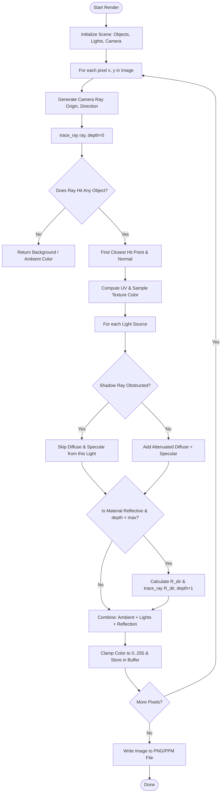

# The Blueprint: 3D Ray Tracing Technical Reference & Roadmap

A comprehensive guide to ray tracing concepts, 3D linear algebra, optical math, UV texture mapping, and software architecture designed for developers building a custom ray tracer in Python without pre-packaged full-code dumps.

---

## 1. The Core Mental Model: How Ray Tracing Works

In the physical world, light travels from light sources (the Sun, a lightbulb), bounces off millions of objects, and a tiny fraction enters the human eye or camera sensor (**Forward Ray Tracing**). Simulating this directly in software is computationally wasteful because over $99.9\%$ of physical rays never reach the camera.

**Ray Tracing (Backward Ray Tracing)** flips this process:
1. You place a virtual eye (Camera) in 3D space.
2. You place a virtual rectangular window (the **Viewport / Image Plane**) in front of the camera.
3. For every single pixel on that window, you shoot a ray from the camera through that pixel out into the 3D scene.
4. You calculate what object that ray hits first.
5. At the collision point, you shoot secondary rays toward light sources to determine shadows, lighting, and reflections.
6. You calculate the final color and write it to the pixel.

```
 [Camera Eye (O)] 
       \
        \  (Primary Ray)
         v
   [Viewport Pixel] ------> [3D Sphere / Object]
                                  \
                                   \ (Shadow Ray)
                                    v
                              [Light Source]
```

### Camera, Viewport, and Field of View (FOV)

* **Camera Position ($\mathbf{O}$):** A 3D coordinate $(x, y, z)$ indicating where the eye is located.
* **Look-At Point ($\mathbf{T}$):** A 3D coordinate the camera is aimed at.
* **Up Vector ($\mathbf{U}_{up}$):** A vector defining which way is "up" (usually $(0, 1, 0)$).
* **Field of View ($\theta$ or $\text{FOV}$):** The angle (horizontal or vertical) of vision. A wider angle captures more of the world (fish-eye effect), while a narrow angle acts like a zoom lens.
* **Aspect Ratio ($A$):** $\text{width} / \text{height}$ (e.g., $16/9$ or $1.0$ for a square image).

#### Viewport Geometry Formulas
If the camera looks down the $-Z$ axis with distance $d$ (focal length, often set to $1.0$):
$$\text{Viewport Height } H = 2 \cdot d \cdot \tan\left(\frac{\text{FOV}}{2}\right)$$
$$\text{Viewport Width } W = A \cdot H$$

For an image of pixel dimensions $N_x \times N_y$, a pixel at column $i \in [0, N_x - 1]$ and row $j \in [0, N_y - 1]$ maps to normalized viewport coordinates $(u, v) \in [0, 1] \times [0, 1]$:
$$u = \frac{i + 0.5}{N_x}, \quad v = \frac{j + 0.5}{N_y}$$

The ray origin is the camera eye $\mathbf{O}$, and the ray direction vector $\mathbf{D}$ is:
$$\mathbf{P}_{\text{pixel}} = \mathbf{P}_{\text{top-left}} + u \cdot \mathbf{V}_{\text{right}} - v \cdot \mathbf{V}_{\text{down}}$$
$$\mathbf{D} = \text{normalize}(\mathbf{P}_{\text{pixel}} - \mathbf{O})$$

---

## 2. 3D Linear Algebra & Transformation Reference

### 2.1 Vectors vs. Points
* **Point $(x, y, z)$:** A fixed location in space.
* **Vector $(v_x, v_y, v_z)$:** A direction and magnitude (length). It has no fixed position.
* **Magnitude (Length) of Vector $\mathbf{v}$:**
  $$\|\mathbf{v}\| = \sqrt{v_x^2 + v_y^2 + v_z^2}$$
* **Unit Vector (Normalization):**
  $$\hat{\mathbf{v}} = \frac{\mathbf{v}}{\|\mathbf{v}\|} = \left(\frac{v_x}{\|\mathbf{v}\|}, \frac{v_y}{\|\mathbf{v}\|}, \frac{v_z}{\|\mathbf{v}\|}\right)$$

### 2.2 The Two Essential Vector Operations

#### 1. Dot Product ($\mathbf{a} \cdot \mathbf{b}$)
Measures how much two vectors point in the same direction.
$$\mathbf{a} \cdot \mathbf{b} = a_x b_x + a_y b_y + a_z b_z = \|\mathbf{a}\| \|\mathbf{b}\| \cos(\theta)$$
* If $\mathbf{a} \cdot \mathbf{b} > 0$: angle is $< 90^\circ$ (pointing in similar directions).
* If $\mathbf{a} \cdot \mathbf{b} = 0$: vectors are perpendicular ($90^\circ$).
* If $\mathbf{a} \cdot \mathbf{b} < 0$: angle is $> 90^\circ$ (pointing away from each other).
* **Used for:** Diffuse lighting, calculating reflections, and finding angles.

#### 2. Cross Product ($\mathbf{a} \times \mathbf{b}$)
Takes two 3D vectors and produces a third vector that is perpendicular (orthogonal) to both.
$$\mathbf{a} \times \mathbf{b} = \begin{pmatrix} a_y b_z - a_z b_y \\ a_z b_x - a_x b_z \\ a_x b_y - a_y b_x \end{pmatrix}$$
* **Used for:** Finding surface normal vectors from triangle vertices and establishing camera coordinate axes.

---

### 2.3 4x4 Transformation Matrices (Homogeneous Coordinates)

To transform any 3D dot, line, square, cube, or mesh vertex, points are represented as 4-element vectors: $\begin{pmatrix} x & y & z & 1 \end{pmatrix}^T$, and vectors as $\begin{pmatrix} x & y & z & 0 \end{pmatrix}^T$.

#### 1. Translation (Moving) by $(\Delta x, \Delta y, \Delta z)$:
$$\mathbf{M}_{\text{translate}} = \begin{pmatrix}
1 & 0 & 0 & \Delta x \\
0 & 1 & 0 & \Delta y \\
0 & 0 & 1 & \Delta z \\
0 & 0 & 0 & 1
\end{pmatrix}$$

#### 2. Scaling by $(S_x, S_y, S_z)$:
$$\mathbf{M}_{\text{scale}} = \begin{pmatrix}
S_x & 0 & 0 & 0 \\
0 & S_y & 0 & 0 \\
0 & 0 & S_z & 0 \\
0 & 0 & 0 & 1
\end{pmatrix}$$

#### 3. Rotations around Coordinate Axes (by angle $\theta$ in radians):

* **Rotation around X-axis:**
  $$\mathbf{R}_x(\theta) = \begin{pmatrix}
  1 & 0 & 0 & 0 \\
  0 & \cos\theta & -\sin\theta & 0 \\
  0 & \sin\theta & \cos\theta & 0 \\
  0 & 0 & 0 & 1
  \end{pmatrix}$$

* **Rotation around Y-axis:**
  $$\mathbf{R}_y(\theta) = \begin{pmatrix}
  \cos\theta & 0 & \sin\theta & 0 \\
  0 & 1 & 0 & 0 \\
  -\sin\theta & 0 & \cos\theta & 0 \\
  0 & 0 & 0 & 1
  \end{pmatrix}$$

* **Rotation around Z-axis:**
  $$\mathbf{R}_z(\theta) = \begin{pmatrix}
  \cos\theta & -\sin\theta & 0 & 0 \\
  \sin\theta & \cos\theta & 0 & 0 \\
  0 & 0 & 1 & 0 \\
  0 & 0 & 0 & 1
  \end{pmatrix}$$

#### 4. Rotation around an Arbitrary User-Defined Unit Vector $\mathbf{k} = (k_x, k_y, k_z)$ (Rodrigues' Rotation Formula)
For any vector $\mathbf{v}$, rotating it by angle $\theta$ around unit axis $\mathbf{k}$ yields:
$$\mathbf{v}_{\text{rot}} = \mathbf{v}\cos\theta + (\mathbf{k} \times \mathbf{v})\sin\theta + \mathbf{k}(\mathbf{k} \cdot \mathbf{v})(1 - \cos\theta)$$

The corresponding $3 \times 3$ rotation matrix ($c = \cos\theta, s = \sin\theta, t = 1 - \cos\theta$):
$$\mathbf{R}_{\mathbf{k}}(\theta) = \begin{pmatrix}
t k_x^2 + c & t k_x k_y - s k_z & t k_x k_z + s k_y \\
t k_x k_y + s k_z & t k_y^2 + c & t k_y k_z - s k_x \\
t k_x k_z - s k_y & t k_y k_z + s k_x & t k_z^2 + c
\end{pmatrix}$$

> [!TIP]
> **Transforming Composite 3D Objects:**
> A cube, square, or abstract model is just a collection of vertices $\mathbf{V}_i$ and faces. Multiplying every vertex by a combined matrix $\mathbf{M} = \mathbf{M}_{\text{trans}} \cdot \mathbf{M}_{\text{rot}} \cdot \mathbf{M}_{\text{scale}}$ transforms the entire object at once.

---

## 3. Ray-Surface Intersection Math

A ray is parameterized by a start position (origin $\mathbf{O}$) and a unit direction vector $\mathbf{D}$:
$$\mathbf{P}(t) = \mathbf{O} + t \cdot \mathbf{D}, \quad t > 0$$
Where $t$ is the distance along the ray.

### 3.1 Ray-Sphere Intersection
For a sphere centered at $\mathbf{C} = (c_x, c_y, c_z)$ with radius $R$:
1. Vector from sphere center to ray origin: $\mathbf{oc} = \mathbf{O} - \mathbf{C}$
2. Quadratic coefficients:
   $$a = \mathbf{D} \cdot \mathbf{D} = 1 \quad (\text{if } \mathbf{D} \text{ is normalized})$$
   $$b = 2 \cdot (\mathbf{oc} \cdot \mathbf{D})$$
   $$c = (\mathbf{oc} \cdot \mathbf{oc}) - R^2$$
3. Discriminant: $\Delta = b^2 - 4ac$
   * If $\Delta < 0$: No intersection (ray missed).
   * If $\Delta \ge 0$: Nearest intersection distance $t = \frac{-b - \sqrt{\Delta}}{2a}$.
4. Hit point: $\mathbf{P} = \mathbf{O} + t \mathbf{D}$
5. Surface Normal at hit point:
   $$\hat{\mathbf{N}} = \frac{\mathbf{P} - \mathbf{C}}{R}$$

### 3.2 Ray-Plane Intersection
For an infinite plane defined by a point on plane $\mathbf{P}_0$ and normal vector $\hat{\mathbf{N}}$:
$$t = \frac{(\mathbf{P}_0 - \mathbf{O}) \cdot \hat{\mathbf{N}}}{\mathbf{D} \cdot \hat{\mathbf{N}}}$$
* If $|\mathbf{D} \cdot \hat{\mathbf{N}}| < 10^{-6}$, the ray is parallel to the plane (no hit).
* If $t > 0$, hit point is $\mathbf{P} = \mathbf{O} + t \mathbf{D}$.

### 3.3 Ray-Triangle Intersection (Möller–Trumbore Algorithm)
Used for rendering 3D polygonal models (.obj meshes, cubes, vases, abstract solids):
Given triangle vertices $\mathbf{V}_0, \mathbf{V}_1, \mathbf{V}_2$:
1. Edge vectors: $\mathbf{E}_1 = \mathbf{V}_1 - \mathbf{V}_0, \quad \mathbf{E}_2 = \mathbf{V}_2 - \mathbf{V}_0$
2. Helper vector: $\mathbf{T} = \mathbf{O} - \mathbf{V}_0, \quad \mathbf{P}_{\text{vec}} = \mathbf{D} \times \mathbf{E}_2, \quad \mathbf{Q}_{\text{vec}} = \mathbf{T} \times \mathbf{E}_1$
3. Determinant: $\text{det} = \mathbf{E}_1 \cdot \mathbf{P}_{\text{vec}}$
   * If $|\text{det}| \approx 0$, ray is parallel to triangle.
4. Barycentric coordinate $u = \frac{\mathbf{T} \cdot \mathbf{P}_{\text{vec}}}{\text{det}}$
   * If $u < 0$ or $u > 1$, ray falls outside.
5. Barycentric coordinate $v = \frac{\mathbf{D} \cdot \mathbf{Q}_{\text{vec}}}{\text{det}}$
   * If $v < 0$ or $u + v > 1$, ray falls outside.
6. Intersection distance $t = \frac{\mathbf{E}_2 \cdot \mathbf{Q}_{\text{vec}}}{\text{det}}$
   * If $t > 0$, valid intersection. Normal $\hat{\mathbf{N}} = \text{normalize}(\mathbf{E}_1 \times \mathbf{E}_2)$.

---

## 4. Optical Physics: Lighting, Shadows, and Color

The total color of a surface point is computed using the **Blinn-Phong Illumination Model** combined with recursive reflection.

$$\text{Final Color} = \mathbf{I}_{\text{ambient}} + \sum_{\text{lights}} \Big[ S \cdot \left( \mathbf{I}_{\text{diffuse}} + \mathbf{I}_{\text{specular}} \right) \cdot \text{Attenuation} \Big] + K_{\text{refl}} \cdot \mathbf{I}_{\text{reflected}}$$

```
               [Light Source]
                    ^
                   / 
       L (Light)  /  N (Surface Normal)
                 /   ^   R (Reflected Ray)
                /    |   ^
               /     |  /
              v      | /  
        ------------------------- (Surface)
                     ^
                      \  V (View / Camera Ray)
                       \
```

### 4.1 Ambient Light
Baseline baseline illumination so unlit areas aren't pitch black:
$$\mathbf{I}_{\text{ambient}} = K_a \cdot \mathbf{C}_{\text{object}} \cdot \mathbf{C}_{\text{ambient\_light}}$$

### 4.2 Diffuse Reflection (Lambertian Cosine Law)
Matte light scattering. Brightest when surface directly faces light:
$$\mathbf{L} = \text{normalize}(\mathbf{P}_{\text{light}} - \mathbf{P}_{\text{hit}})$$
$$\mathbf{I}_{\text{diffuse}} = K_d \cdot \mathbf{C}_{\text{object}} \cdot \mathbf{C}_{\text{light}} \cdot \max(0, \hat{\mathbf{N}} \cdot \mathbf{L})$$

### 4.3 Specular Highlights (Blinn-Phong)
Glossy shiny spots (reflections of the light source bulb):
$$\mathbf{V} = \text{normalize}(\mathbf{O} - \mathbf{P}_{\text{hit}})$$
$$\mathbf{H} = \text{normalize}(\mathbf{L} + \mathbf{V}) \quad (\text{Halfway vector})$$
$$\mathbf{I}_{\text{specular}} = K_s \cdot \mathbf{C}_{\text{light}} \cdot \left(\max(0, \hat{\mathbf{N}} \cdot \mathbf{H})\right)^{\text{shininess}}$$
*(Higher `shininess`, e.g., $32$ to $256$, produces tighter, sharper highlights).*

### 4.4 Light Dropoff & Attenuation (Inverse-Square Law)
Luminosity decays as light spreads out over distance $d = \|\mathbf{P}_{\text{light}} - \mathbf{P}_{\text{hit}}\|$:
$$\text{Attenuation} = \frac{1}{k_c + k_l \cdot d + k_q \cdot d^2}$$
*(Physically pure dropoff uses $1 / d^2$; the constant $k_c$ and linear $k_l$ terms prevent division by zero and give artistic control).*

### 4.5 Shadow Rays
To test if a point $\mathbf{P}_{\text{hit}}$ is in shadow:
1. Construct a shadow ray with origin $\mathbf{P}_{\text{hit}} + \epsilon \hat{\mathbf{N}}$ and direction $\mathbf{L}$.
2. If this ray intersects any object before reaching the light (distance $< d$), set shadow factor $S = 0$; otherwise $S = 1$.

### 4.6 Mirror Reflections (Law of Reflection)
For reflective surfaces with reflectivity coefficient $K_{\text{refl}} \in [0, 1]$:
$$\mathbf{R}_{\text{dir}} = \mathbf{D} - 2(\mathbf{D} \cdot \hat{\mathbf{N}})\hat{\mathbf{N}}$$
Spawn a recursive secondary ray with origin $\mathbf{P}_{\text{hit}} + \epsilon \hat{\mathbf{N}}$ and direction $\mathbf{R}_{\text{dir}}$. Call `trace_ray()` with recursion depth limit (typically 3 to 5 bounces).

---

## 5. UV Texture Mapping on Abstract 3D Shapes

Texture mapping is the process of converting a 3D intersection point $(x, y, z)$ on an object into 2D image coordinates $(u, v) \in [0, 1] \times [0, 1]$ to sample colors from a bitmap image.

### 5.1 Sphere UV Mapping (Spherical Coordinates)
For a unit sphere centered at origin, given hit normal $\hat{\mathbf{N}} = (n_x, n_y, n_z)$:
$$u = 0.5 + \frac{\text{atan2}(n_z, n_x)}{2\pi}$$
$$v = 0.5 - \frac{\arcsin(n_y)}{\pi}$$

### 5.2 Cylinder / Can UV Mapping
For a cylinder with radius $R$, height $H$, aligned along the Y-axis:
$$u = 0.5 + \frac{\text{atan2}(z, x)}{2\pi}$$
$$v = \frac{y - y_{\text{min}}}{H}$$

### 5.3 Cube UV Mapping (Triplanar / Box Mapping)
Find the dominant axis of the surface normal $\hat{\mathbf{N}} = (n_x, n_y, n_z)$:
* If $|n_x| \ge |n_y|$ and $|n_x| \ge |n_z|$ (Hit left/right face): $u = z, \ v = y$
* If $|n_y| \ge |n_x|$ and $|n_y| \ge |n_z|$ (Hit top/bottom face): $u = x, \ v = z$
* If $|n_z| \ge |n_x|$ and $|n_z| \ge |n_y|$ (Hit front/back face): $u = x, \ v = y$
*(Normalize $(u, v)$ to range $[0, 1]$ based on cube bounds).*

### 5.4 Abstract Shapes & Vases (Surfaces of Revolution)
A vase is defined by revolving a 2D profile curve $r = f(y)$ around the central vertical axis (Y-axis):
1. **Vertical Coordinate ($v$):** Directly parameterized by the relative height along the vase:
   $$v = \frac{y - y_{\text{bottom}}}{y_{\text{top}} - y_{\text{bottom}}}$$
2. **Horizontal / Radial Coordinate ($u$):** Parameterized by the polar angle around the axis:
   $$\theta = \text{atan2}(z, x) \quad \in [-\pi, \pi]$$
   $$u = \frac{\theta + \pi}{2\pi}$$
3. For polygon meshes of vases (.obj files), use the mesh's exported vertex UV coordinates via **Barycentric Interpolation**:
   $$\text{UV}_{\text{hit}} = (1 - u_{\text{bary}} - v_{\text{bary}})\text{UV}_0 + u_{\text{bary}}\text{UV}_1 + v_{\text{bary}}\text{UV}_2$$

---

## 6. Software Architecture & Implementation Roadmap



### Modular Function Checklist to Build

1. **Math & Linear Algebra Module:**
   - `Vec3` operations: `add`, `sub`, `mul_scalar`, `dot`, `cross`, `length`, `normalize`, `reflect`.
   - `Mat4` operations: `matrix_multiply`, `translation_matrix`, `scale_matrix`, `rotation_x/y/z`, `rodrigues_rotation`.
2. **Ray & Geometry Module:**
   - `Ray(origin, direction)`
   - `HitRecord(t, point, normal, material, u, v)`
   - Primitive intersection methods: `intersect_sphere`, `intersect_plane`, `intersect_triangle`, `intersect_aabb`.
3. **Materials & Textures Module:**
   - `Material(albedo_color, ambient_k, diffuse_k, specular_k, shininess, reflectivity, texture_map)`
   - `sample_texture(image_array, u, v)` with nearest-neighbor or bilinear interpolation.
4. **Camera & Scene Module:**
   - `Camera(eye, look_at, up, fov, aspect_ratio)`
   - `Scene(objects_list, lights_list, ambient_light)`
5. **Renderer Engine:**
   - `trace_ray(scene, ray, depth)`
   - `render_image(camera, scene, width, height, samples_per_pixel)`

---

## 7. Pioneer Pitfalls: The Hard Lessons

> [!WARNING]
> ### 1. "Shadow Acne" and Self-Intersection
> **The Problem:** Due to floating-point imprecision, a hit point $\mathbf{P}$ calculated on a sphere might lie slightly *inside* the sphere ($t \approx 0.000001$). When you cast a shadow ray or reflection ray from $\mathbf{P}$, it immediately hits *itself*, creating black speckles all over the object.
> **The Solution:** Always offset secondary ray origins along the surface normal:
> $$\mathbf{O}_{\text{new}} = \mathbf{P} + \epsilon \cdot \hat{\mathbf{N}} \quad (\text{where } \epsilon \approx 10^{-4})$$

> [!CAUTION]
> ### 2. Unnormalized Direction Vectors
> If your ray direction $\mathbf{D}$ or normal $\hat{\mathbf{N}}$ is not unit length ($\|\mathbf{v}\| \neq 1$), dot products no longer represent cosine angles, distances ($t$) get scaled incorrectly, and lighting calculations will blow out or vanish.
> **The Rule:** Re-normalize directions whenever creating rays, and re-normalize normals after intersection.

> [!NOTE]
> ### 3. Python Performance Bottleneck
> Pure Python loops over $1920 \times 1080 = 2,073,600$ pixels with reflection bounces can take minutes per frame.
> **Optimization Strategy:**
> 1. Start with pure Python / `NumPy` for 100x100 resolution tests.
> 2. Use **Taichi Lang (`import taichi as ti`)** or **Numba (`@njit`)** to JIT-compile your ray tracing math to multi-threaded CPU or GPU shaders.

---

## 8. Recommended Libraries & Reference Guides

### Recommended Python Stack
* **Taichi Lang (`pip install taichi`):** Allows writing Python code that compiles to high-performance GPU/C++ binaries. Ideal for ray tracers and graphics shaders.
* **NumPy (`pip install numpy`):** Vectorized array math and matrix multiplications.
* **Pillow (`pip install pillow`):** For loading texture images (PNG/JPG) and saving output renders.
* **Pygame (`pip install pygame`):** Optional, if you want a live window updating pixel-by-pixel as it renders.

### Essential Reading & Tutorials
* [Scratchapixel 2.0 (From Scratch to Render)](https://www.scratchapixel.com/) — The industry gold-standard guide covering the exact linear algebra, geometry, and camera math for computer graphics.
* [Ray Tracing in One Weekend by Peter Shirley](https://raytracing.github.io/books/RayTracingInOneWeekend.html) — The most famous step-by-step introduction to ray tracing architecture.
* [Inigo Quilez Graphics Articles](https://iquilezles.org/articles/) — Mathematical formulas for ray intersections, 3D rotations, and procedural shading.
* [Taichi Graphics Ray Tracing Docs](https://docs.taichi-lang.org/) — Guides on writing accelerated graphics kernels in Python.
